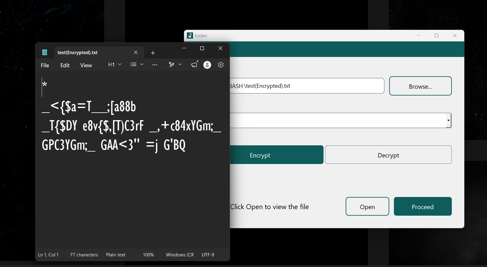
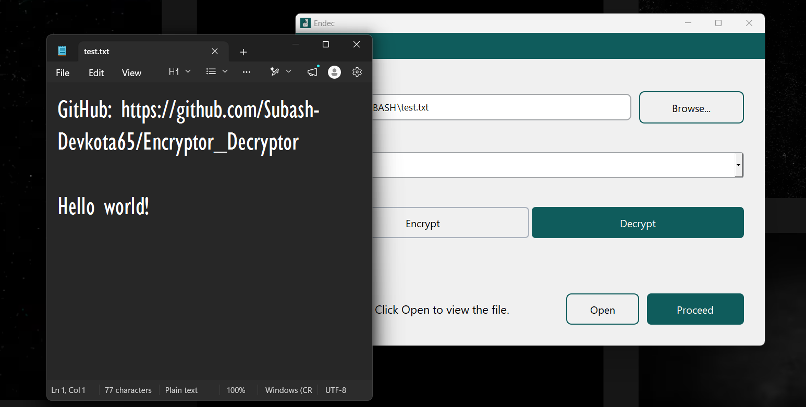

# Endec

A small desktop app for encrypting and decrypting text files, built with Python and PyQt5.

Pick a `.txt` file, choose a channel, choose **Encrypt** or **Decrypt**, and press **Proceed**.

> **Note:** Endec is a learning project. It uses a simple substitution cipher, which is **not secure**. Don't use it to protect anything private. For real encryption, use a vetted library such as [`cryptography`](https://cryptography.io/) (Fernet).
<br>

<br>



## Features

- Clean single-window interface
- 100 selectable channels, each with its own substitution key
- Encrypt or decrypt with one click
- Status line that shows what will happen (for example, `Encrypt 'notes.txt' via Channel 3`)
- Output is renamed automatically: `notes.txt` becomes `notes(Encrypted).txt`, and decrypting restores the original name
- **Open** button to view the result in your default text editor

## How it works

Every character is replaced by a different character from a shuffled list, and the list used depends on the selected channel. The characters supported are:

- letters (`a-z`, `A-Z`)
- digits (`0-9`)
- punctuation
- space, newline and tab

Decrypting reverses the substitution with the same channel's key, so a file must be decrypted with the same channel it was encrypted with.

## Requirements

- Python 3.9 or newer
- PyQt5

```bash
pip install PyQt5
```

## Setup

### 1. Get the code

```bash
git clone https://github.com/your-username/endec.git
cd endec
```

### 2. Create the keys file

Endec reads its keys from `encryption_keys.json` in the project folder. This file is **not** included in the repository, so each user generates their own. Keep it private: anyone with the file can decrypt your files.

Create `generate_keys.py` next to the app and run it once:

```python
import json
import random
import string

chars = list(string.ascii_letters + " " + string.punctuation + string.digits + "\n" + "\t")

keys = {}
for channel in range(100):          # channels 1 to 100 are stored as "0" to "99"
    shuffled = chars.copy()
    random.shuffle(shuffled)
    keys[str(channel)] = shuffled

with open("encryption_keys.json", "w", encoding="utf-8") as f:
    json.dump(keys, f)
```

```bash
python generate_keys.py
```

> If you lose or regenerate `encryption_keys.json`, files encrypted with the old keys can no longer be decrypted.

### 3. Run the app

```bash
python main.py
```

(Replace `main.py` with the name of your script.)

## Usage

1. Click **Browse...** and choose a `.txt` file.
2. Pick a **Channel** from the dropdown.
3. Choose **Encrypt** or **Decrypt**.
4. Click **Proceed**.
5. Click **Open** to view the result.

To decrypt, select the encrypted file (`name(Encrypted).txt`), choose the **same channel** used to encrypt it, and select **Decrypt**.

## Known limitations

- Only plain `.txt` files are supported.
- Characters outside the supported set (for example, accented letters, emoji, or Windows `\r` line endings) are not handled and can cause an error.
- The original file is overwritten and renamed rather than copied, so keep a backup of anything important.
- The substitution cipher can be broken easily and offers no real security.

## Project structure

```
endec/
├── main.py                  # the application
├── endec_logo.png           # window icon
├── generate_keys.py         # creates encryption_keys.json
├── encryption_keys.json     # your private keys (not committed)
└── README.md
```

## Ideas for the future

- Password-based keys instead of a stored key file
- Support for any file type by working with bytes
- Progress bar for large files
- Proper encryption with `cryptography` (Fernet)
- Packaged `.exe` release with PyInstaller

